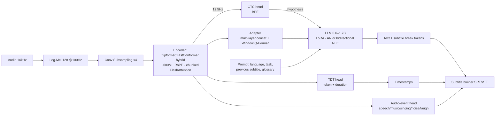

# پیشنهاد معماری: مدل زیرنویس‌ساز نسل جدید (جایگزین Whisper Turbo)

> وضعیت: پیشنهاد طراحی · تاریخ بررسی منابع: اکتبر ۲۰۲۶
> هدف: کیفیت بالاتر از Whisper-large-v3-turbo روی دیتای مشابه، سرعت بیشتر، مقاومت بالا در برابر موسیقی/آواز، زمان‌بندی دقیق زیرنویس، قابل آموزش به‌صورت تک‌زبانه (مثلاً فارسی) یا چندزبانه.

---

## ۱. خلاصهٔ تصمیم

**پیشنهاد: یک مدل واحد با دو «سر» (Head)، نه دو سیستم جدا.**

یک Encoder قوی صوتی که خودش به‌تنهایی با سر CTC/TDT متن و زمان‌بندی تولید می‌کند، به‌علاوهٔ یک LLM کوچک (۰٫۶ تا ۱٫۷ میلیارد پارامتر) که روی همان Encoder سوار شده و متن را با درک زبانی و بافت (context) کامل یا اصلاح می‌کند.

| حالت اجرا | مسیر | کاربرد |
|---|---|---|
| **Fast** | Encoder → TDT/CTC | سریع‌ترین، بدون LLM، چند برابر سریع‌تر از Whisper Turbo |
| **Edit (پیش‌فرض)** | Encoder → CTC hypothesis → LLM دوطرفه یک‌پاسه (NLE) | تقریباً کیفیت AR با سرعت نزدیک CTC |
| **Quality** | Encoder → Adapter → LLM خودبازگشتی (AR) | بیشترین دقت؛ اسامی خاص، موسیقی، صدای سخت، ترجمه |

چرا این ترکیب؟ وضعیت فعلی پژوهش (۲۰۲۶) دقیقاً همین را نشان می‌دهد:

- صدر Open ASR Leaderboard در اختیار مدل‌های **Encoder + LLM** است: Granite-Speech-4.1-2B (میانگین WER ≈ ۵٫۳۳)، Qwen3-ASR-1.7B، Canary-Qwen-2.5B (≈ ۵٫۶۳). Whisper-large-v3 / turbo دیگر در صدر نیست.
- در مقابل، Cohere Transcribe (≈ ۲B، بیش از ۹۰٪ پارامترها در Encoder و یک Decoder سبک) نشان داد که **Encoder بزرگ + Decoder کوچک** هم تقریباً به همان دقت می‌رسد و خیلی ارزان‌تر است.
- مقالهٔ NLE (IBM، مارس ۲۰۲۶) نشان داد که LLM می‌تواند به‌جای تولید توکن‌به‌توکن، **فرضیهٔ CTC را در یک پاس ویرایش کند**: ۵٫۶۷٪ WER با RTFx ≈ ۱۶۳۰ و ۲۷ برابر سریع‌تر از حالت AR در درخواست‌های تکی.
- Qwen3-ASR در گزارش فنی‌اش روی آواز و آهنگ کامل با موسیقی پس‌زمینه نتایج قوی گزارش کرده (WER ≈ ۱۴٫۶ روی آهنگ انگلیسی کامل)، در حالی که Whisper-large-v3 روی آهنگ‌های طولانی اصلاً جواب قابل‌قبولی نداده است. عامل اصلی: داده و پیش‌آموزش عظیم + مرحلهٔ RL.

نتیجه: «فقط LLM» گران و مستعد توهم (hallucination) است؛ «فقط Encoder» در اسامی، بافت و صداهای مبهم ضعیف‌تر است. طراحی هیبریدی با اشتراک Encoder، هر دو مزیت را می‌دهد و اجازه می‌دهد در زمان اجرا بین سرعت و کیفیت انتخاب کنید.

---

## ۲. نقاط ضعف Whisper Turbo که باید حل شوند

| مشکل Whisper-large-v3-turbo | علت معماری | راه‌حل در طراحی جدید |
|---|---|---|
| ورودی همیشه به ۳۰ ثانیه pad می‌شود | Encoder با طول ثابت | Encoder با طول متغیر + attention پنجره‌ای |
| نرخ فریم ۵۰Hz در Encoder (۱۵۰۰ فریم برای ۳۰s) | زیرنمونه‌برداری فقط ۲ برابر | زیرنمونه‌برداری ۸ برابر (۱۲٫۵Hz)، هزینهٔ attention ≈ ۱/۱۶ |
| توهم در سکوت و موسیقی، تکرار حلقه‌ای | Decoder خودبازگشتی بدون قید هم‌ترازی | قید CTC روی LLM + سر تشخیص رویداد صوتی + RL |
| زمان‌بندی (timestamp) ضعیف و تقریبی | توکن‌های زمانی ۲۰ms در Decoder | زمان‌بندی مستقیم از TDT + Aligner غیرخودبازگشتی |
| حافظهٔ بافت فقط از متن قبلی در prompt | — | prompt غنی: متن قبلی، واژه‌نامه، اسامی، زبان، نوع محتوا |
| پیش‌آموزش فقط نظارت‌شدهٔ ضعیف | بدون SSL | پیش‌آموزش خودنظارتی BEST-RQ روی صوت متنوع (شامل موسیقی) |

---

## ۳. معماری کلی

### ۳.۱ ورودی (Front-end)
- Log-Mel با ۱۲۸ کانال، پنجرهٔ ۲۵ms، گام ۱۰ms (سازگار با Whisper-v3 برای بازاستفاده از ابزارها).
- SpecAugment + افزونگی داده‌ای در سطح موج (بخش ۵).
- **اختیاری برای موسیقی سنگین:** شاخهٔ جداسازی صدای خواننده (مدل‌های خانوادهٔ BS-/Mel-RoFormer) که **فقط وقتی سر Audio-event موسیقی تشخیص دهد** فعال می‌شود. خروجی vocal و میکس اصلی به‌صورت دو کانال ورودی به Encoder داده می‌شوند (کانال دوم در آموزش با احتمال ۵۰٪ صفر می‌شود تا مدل بدون آن هم کار کند). این کار هزینه را فقط برای بخش‌های موسیقی‌دار اضافه می‌کند.

### ۳.۲ Encoder (قلب مدل)
پیشنهاد: **FastConformer با ایده‌های Zipformer**

| پارامتر | مقدار پیشنهادی (نسخهٔ Base) |
|---|---|
| زیرنمونه‌برداری | Conv عمق‌جدا ×۸ → ۱۲٫۵Hz (۸۰ms/فریم) |
| لایه‌ها | ۲۴ بلوک Conformer، d_model=۱۰۲۴، ۱۶ head، FFN=۴۰۹۶ |
| کرنل کانولوشن | ۹ (depthwise) |
| موقعیت | RoPE (به‌جای positional ثابت Whisper) |
| attention | chunked/dynamic window (۱ تا ۸ ثانیه در آموزش تصادفی) + چند توکن «حافظه» سراسری → یک مدل هم streaming هم offline |
| نرمال‌سازی | Pre-LN + RMSNorm، فعال‌سازی SwiGLU |
| اندازه | ≈ ۶۰۰M (Lite: ≈ ۲۰۰M با ۱۷ لایه و d=۵۱۲) |

چرا ۸ برابر؟ با ۱۲٫۵Hz، دنبالهٔ ۳۰ ثانیه فقط ۳۷۵ فریم است (Whisper: ۱۵۰۰). هم Encoder چند برابر سریع‌تر می‌شود، هم ورودی LLM کوتاه است (همان نرخی که Qwen3-ASR استفاده می‌کند؛ Granite با ۱۰Hz).

### ۳.۳ سرهای Encoder
1. **CTC (BPE)** — برای فرضیهٔ اولیهٔ حالت Edit، و برای قیدگذاری روی LLM (CTC prefix scoring) تا توهم کم شود.
2. **TDT (Token-and-Duration Transducer)** — همان چیزی که Parakeet-TDT را سریع و دقیق کرده. با پیش‌بینی مدت‌زمان، از فریم‌های خالی می‌پرد و **زمان‌بندی کلمه‌ای را مستقیم** می‌دهد. حالت Fast فقط از همین استفاده می‌کند.
3. **Audio-event (چندبرچسبی، فریم‌به‌فریم)** — گفتار / آواز / موسیقی بی‌کلام / نویز / خنده / سکوت. دو کاربرد: (الف) تولید برچسب‌هایی مثل «[موسیقی]» در زیرنویس، (ب) جلوگیری از تولید متن در بخش‌های بدون گفتار (ریشهٔ اصلی توهم Whisper).

برای یکپارچگی، می‌توان از ایدهٔ Granite استفاده کرد: CTC دوگانه (یکی روی نویسه/grapheme در لایه‌های میانی، یکی روی BPE در خروجی) به‌عنوان InterCTC که همگرایی را سریع‌تر می‌کند.

### ۳.۴ Adapter (پل بین صوت و LLM)
- الحاق hidden state های لایه‌های ۶، ۱۲، ۱۸، ۲۴ Encoder (مانند Granite NAR) → اطلاعات آکوستیک سطح پایین هم به LLM می‌رسد (برای آواز و لهجه مهم است).
- **Window Q-Former** دو لایه با پنجرهٔ ۱ ثانیه‌ای و ۱۰ تا ۱۲ query در هر پنجره → نرخ ثابت ≈ ۱۰–۱۲٫۵ توکن در ثانیه.
- اندازه ≈ ۲۰ تا ۱۶۰M.

### ۳.۵ LLM
- پایه: یک LLM چندزبانهٔ کوچک با توکنایزر کارآمد برای زبان هدف (مثلاً خانوادهٔ Qwen3 ۰٫۶B/۱٫۷B؛ برای فارسی، کارایی توکنایزر را حتماً بسنجید — تعداد توکن به ازای هر کلمه مستقیماً سرعت را تعیین می‌کند).
- آموزش با LoRA (rank ۶۴–۱۲۸) + آموزش کامل Adapter. منجمد نگه داشتن بیشتر LLM، دانش زبانی‌اش را حفظ می‌کند.
- **دو حالت روی همان وزن‌ها:**
  - **AR (خودبازگشتی):** prompt + توکن‌های صوتی → متن. برای بیشترین کیفیت و ترجمه.
  - **NLE (ویرایش غیرخودبازگشتی):** attention دوطرفه؛ ورودی = توکن‌های صوتی + فرضیهٔ CTC با padding میان‌لایه‌ای؛ خروجی با هدف latent alignment (شبیه CTC) در یک پاس. یک LoRA جدا برای این حالت.
- **Prompt غنی مخصوص زیرنویس:** زبان، نوع محتوا (فیلم/موزیک‌ویدیو/مستند)، دو جملهٔ زیرنویس قبلی، فهرست اسامی و اصطلاحات (keyword biasing). این یکی از بزرگ‌ترین مزیت‌های LLM نسبت به Whisper است.
- **توکن‌های ویژهٔ زیرنویس:** ` ` (شکست خط) و `<cue>` (شروع زیرنویس جدید) تا LLM خودش تقسیم‌بندی خوانا را یاد بگیرد (حداکثر ۴۲ نویسه در خط، ۱ تا ۷ ثانیه).

### ۳.۶ زمان‌بندی (Timestamps)
- منبع اول: مدت‌زمان‌های TDT → زمان شروع/پایان هر توکن.
- برای حالت AR/NLE که متن با CTC فرق می‌کند: **Aligner غیرخودبازگشتی** به سبک Qwen3-ForcedAligner (متن با جای‌خالی‌های `[time]` به LLM داده می‌شود و یک لایهٔ خطی، شاخص زمانی ۸۰ms هر جای خالی را هم‌زمان پیش‌بینی می‌کند). گزارش نویسندگان: خطای میانگین ≈ ۳۲ms. این Aligner همان LLM با یک LoRA و یک head دیگر است، نه مدل جدا.

### ۳.۷ صوت طولانی (فیلم کامل)
- VAD سبک از سر Audio-event → قطعه‌بندی روی مرزهای طبیعی (نه برش کورِ ۳۰ ثانیه‌ای).
- قطعه‌های تا ۶۰ ثانیه برای Encoder (attention پنجره‌ای این را ارزان می‌کند).
- متن قطعهٔ قبلی در prompt قطعهٔ بعد، ولی **با قید CTC** تا خطای قبلی منتشر نشود.

---

## ۴. اندازه‌ها و بودجهٔ محاسباتی

| نسخه | Encoder | Adapter | LLM | جمع | مقایسه |
|---|---|---|---|---|---|
| **Lite** (تک‌زبانه/موبایل) | ۲۰۰M | — | — | ≈ ۰٫۲B | حالت Fast فقط |
| **Base** | ۶۰۰M | ۴۰M | ۰٫۶B | ≈ ۱٫۲B | هم‌رده با Qwen3-ASR-0.6B |
| **Large** | ۸۰۰M | ۱۶۰M | ۱٫۷B | ≈ ۲٫۷B | هم‌رده با Granite/Canary-Qwen |
| Whisper-large-v3-turbo | ≈ ۶۳۵M (۳۲ لایه، ۵۰Hz) | — | Decoder ۴ لایه | ≈ ۰٫۸B | مبنا |

انتظار سرعت (تخمینی، باید اندازه‌گیری شود): Encoder نسخهٔ Base به‌خاطر نرخ ۱۲٫۵Hz و حذف padding ۳۰ ثانیه، با وجود اندازهٔ مشابه، چند برابر سریع‌تر از Encoder Whisper Turbo است. حالت Fast از Whisper Turbo بسیار سریع‌تر است؛ حالت Edit تقریباً هم‌سرعت یا سریع‌تر؛ حالت AR کندتر ولی دقیق‌تر.

بهینه‌سازی اجرا: FlashAttention، bf16/FP8 در آموزش، INT8/INT4 (AWQ/GGUF) برای LLM در استنتاج، batching پویا، KV-cache برای حالت AR، و speculative decoding با فرضیهٔ CTC به‌عنوان «پیش‌نویس» (LLM فقط تأیید/اصلاح می‌کند).

---

## ۵. دستور آموزش (Training Recipe)

### مرحلهٔ ۰ — آماده‌سازی داده
- **برچسب‌گذاری کاذب و پالایش** به سبک Granary (NVIDIA): قطعه‌بندی → استنتاج دوپاسه → تأیید زبان → فیلتر متن → بازگردانی نقطه‌گذاری. Granary با این روش با ≈ ۵۰٪ دادهٔ کمتر به کارایی مشابه رسیده است.
- برای شرط «دیتاست مشابه Whisper»: همان حجم/منابع، ولی **پالایش‌شده**. کیفیت برچسب از حجم مهم‌تر است.
- منابع عمومی: YODAS، YouTube-Commons، Granary، Common Voice، FLEURS، MLS، Emilia، People's Speech، و برای فارسی: Common Voice fa، ParsVoice و دادهٔ زیرنویس فیلم‌های دارای مجوز.
- **نرمال‌سازی متن فارسی** (حیاتی برای WER منصفانه): یکسان‌سازی ی/ي و ک/ك، نیم‌فاصله (ZWNJ)، اعداد، علائم.

### مرحلهٔ ۱ — پیش‌آموزش خودنظارتی Encoder
- BEST-RQ (random-projection quantizer؛ ساده و مقیاس‌پذیر) روی صوت **بدون برچسب و متنوع**: گفتار، **موسیقی، آواز**، پادکست، فیلم. این مهم‌ترین گام برای مقاومت در برابر موسیقی است: Encoder قبل از دیدن متن، ساختار صوت مخلوط را یاد می‌گیرد.

### مرحلهٔ ۲ — آموزش نظارت‌شدهٔ Encoder
- هدف: TDT + CTC (+ InterCTC) + Audio-event.
- **افزونگی موسیقی:** میکس گفتار با موسیقی (FMA، MUSDB، Jamendo؛ با مجوز مناسب) در SNR تصادفی از −۵ تا +۲۰ dB، نویز MUSAN، پژواک (RIR)، فشرده‌سازی کدک (MP3/AAC/Opus)، تغییر سرعت.
- اندازهٔ batch پویا بر حسب طول، آموزش با قطعه‌های ۵ تا ۶۰ ثانیه.

### مرحلهٔ ۳ — هم‌ترازی Adapter
- LLM و Encoder منجمد، فقط Adapter؛ وظیفهٔ ASR ساده.

### مرحلهٔ ۴ — تنظیم مشترک
- Encoder (با نرخ یادگیری کم) + Adapter + LoRA؛ چند وظیفه: ASR، ASR با بافت/واژه‌نامه، ترجمه (اختیاری)، NLE، Alignment، تقسیم‌بندی زیرنویس.
- ۱۰ تا ۲۰٪ داده با prompt خالی تا مدل به prompt وابسته نشود.

### مرحلهٔ ۵ — برنامهٔ درسی آواز و موسیقی
- داده‌های lyrics هم‌تراز: DALI، JamendoLyrics، MUSDB-lyrics، M4Singer، Opencpop و آهنگ‌های فارسی با متن.
- برچسب سبک زیرنویس برای بخش‌های بی‌کلام: «♪ [موسیقی] ♪».

### مرحلهٔ ۶ — یادگیری تقویتی (RL)
- GRPO/MWER با پاداش ترکیبی: −WER، جریمهٔ درج (insertion) در بخش‌های غیرگفتاری، جریمهٔ تکرار، پاداش دقت زمان‌بندی. Qwen3-ASR گزارش کرده که مرحلهٔ RL مقاومت در برابر نویز را بهبود داده است.

### مرحلهٔ ۷ — تقطیر و فشرده‌سازی
- تقطیر Large → Base → Lite (هم برچسب کاذب، هم logit).
- کوانتیزه‌سازی و آزمون کیفیت پس از آن.

### تک‌زبانه در برابر چندزبانه
- **تک‌زبانه (مثلاً فارسی):** همان معماری؛ توکنایزر BPE مخصوص زبان برای سرهای CTC/TDT (۱ تا ۴ هزار واحد)، LLM با توکنایزر کارآمد برای آن زبان. نسخهٔ Lite تک‌زبانه معمولاً از Whisper چندزبانه در همان زبان بسیار بهتر است.
- **چندزبانه:** توکنایزر مشترک ≈ ۸ تا ۱۶ هزار واحد برای CTC/TDT، نمونه‌برداری دمادار زبان‌ها (temperature ≈ ۰٫۵) تا زبان‌های کم‌منبع گم نشوند، توکن زبان در prompt، و سر LID روی Encoder.

---

## ۶. ارزیابی

| محور | معیار | داده |
|---|---|---|
| دقت عمومی | WER/CER با نرمال‌سازی یکسان | Open ASR Leaderboard، FLEURS، Common Voice |
| دقت زبان هدف | WER/CER | آزمون اختصاصی فارسی (گفتار محاوره‌ای + فیلم) |
| موسیقی و آواز | WER | JamendoLyrics، MUSDB-lyrics، آهنگ‌های فارسی |
| توهم | نرخ درج در بخش‌های بدون گفتار | سکوت، موسیقی بی‌کلام، نویز |
| زمان‌بندی | خطای میانگین مرز کلمه (ms)، درصد زیرنویس با خطای >۲۰۰ms | دادهٔ دستی‌برچسب‌خورده |
| خوانایی زیرنویس | طول خط، مدت نمایش، سرعت خواندن (CPS) | — |
| کارایی | RTFx، حافظهٔ GPU، تأخیر | GPU هدف |

**مقایسهٔ منصفانه با Whisper:** یک بار Whisper-large-v3-turbo را روی همان دادهٔ پالایش‌شدهٔ شما fine-tune کنید و مدل جدید را با آن مقایسه کنید؛ وگرنه بهبود داده و بهبود معماری از هم جدا نمی‌شوند.

---

## ۷. ریسک‌ها و ملاحظات
- **توهم LLM:** با قید CTC، سر Audio-event و RL کنترل می‌شود؛ ولی باید جداگانه اندازه‌گیری شود.
- **هزینهٔ آموزش:** نسخهٔ Large از صفر به ده‌ها تا صدها هزار ساعت GPU نیاز دارد. مسیر ارزان‌تر: شروع از وزن‌های باز (Encoder یک مدل باز موجود + LLM باز) و فقط اجرای مراحل ۲ به بعد.
- **مجوز داده:** دادهٔ موسیقی و زیرنویس فیلم معمولاً حق نشر دارد؛ فقط از منابع با مجوز مناسب استفاده شود.
- **ادعاهای منابع:** بیشتر اعداد این سند از گزارش خود سازندگان مدل‌ها است و باید روی دادهٔ خودتان بازتولید شود.

## ۸. نقشهٔ راه پیشنهادی
1. ساخت مجموعهٔ ارزیابی (فارسی + موسیقی + فیلم) و اندازه‌گیری Whisper Turbo و چند مدل باز (Qwen3-ASR، Granite-Speech-4.1، Parakeet-TDT، Cohere Transcribe) روی آن.
2. نمونهٔ اولیهٔ Lite (Encoder + TDT/CTC) روی زبان هدف → مقایسه با Whisper Turbo fine-tuned.
3. افزودن Adapter + LLM و حالت‌های AR/NLE.
4. برنامهٔ موسیقی، RL و Aligner.
5. تقطیر، کوانتیزه‌سازی و خط لولهٔ تولید SRT/VTT.

---

## منابع
- Qwen3-ASR Technical Report — https://arxiv.org/pdf/2601.21337
- NLE: Non-autoregressive LLM-based ASR by Transcript Editing — https://arxiv.org/abs/2603.08397
- Canary-1B-v2 & Parakeet-TDT-0.6B-v3 — https://arxiv.org/abs/2509.14128
- Granary dataset — https://arxiv.org/abs/2505.13404
- Voxtral Realtime — https://arxiv.org/abs/2602.11298
- Omnilingual ASR (1600+ languages) — https://arxiv.org/abs/2511.09690
- VocalParse (singing transcription on Qwen3-ASR) — https://www.emergentmind.com/papers/2605.04613
- Granite Speech 4.1 — https://www.marktechpost.com/2026/04/30/ibm-releases-two-granite-speech-4-1-2b-models-autoregressive-asr-with-translation-and-non-autoregressive-editing-for-fast-inference/
- Cohere Transcribe — https://docs.cohere.com/docs/transcribe
- Open ASR Leaderboard — https://huggingface.co/spaces/hf-audio/open_asr_leaderboard
- ParsVoice (Persian) — https://arxiv.org/abs/2510.10774
